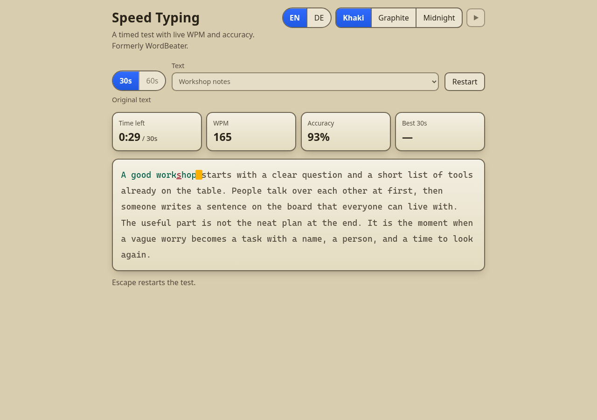
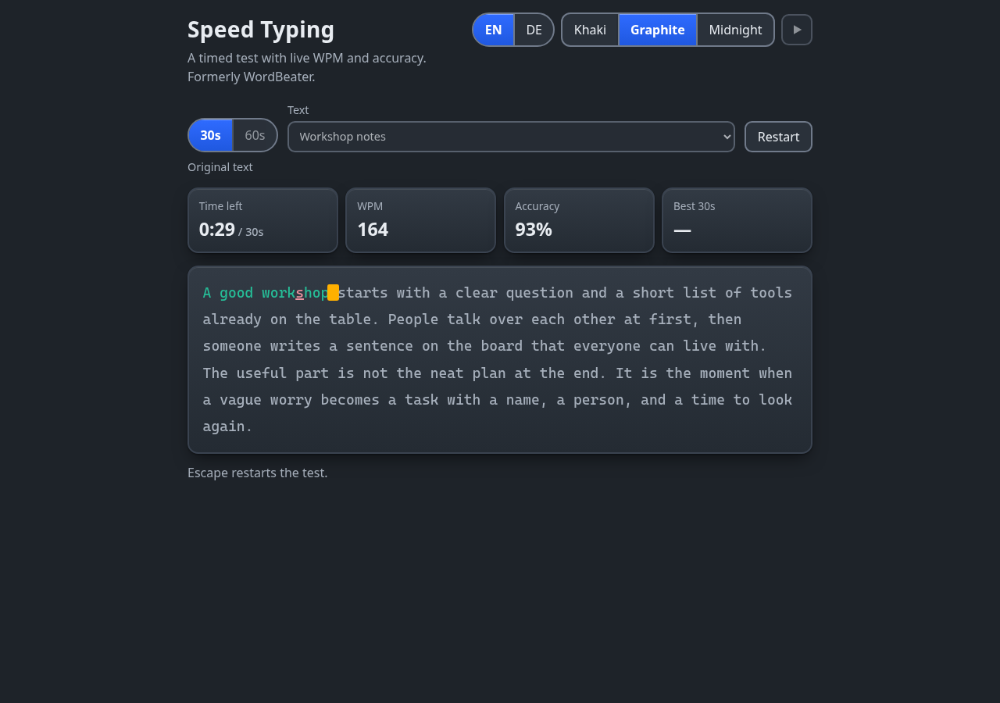
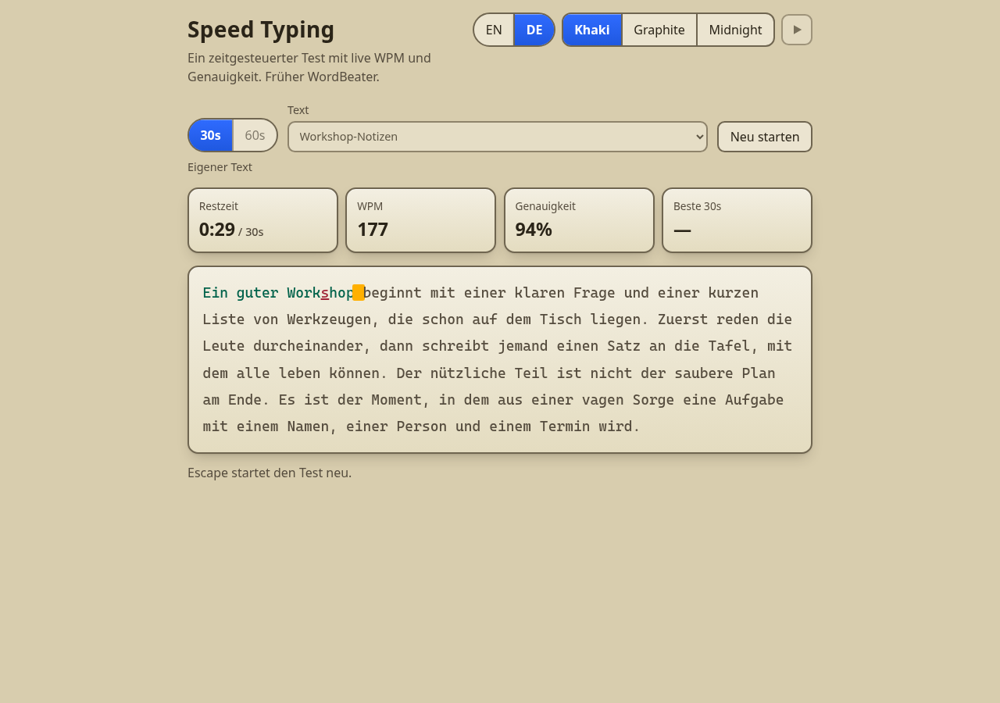
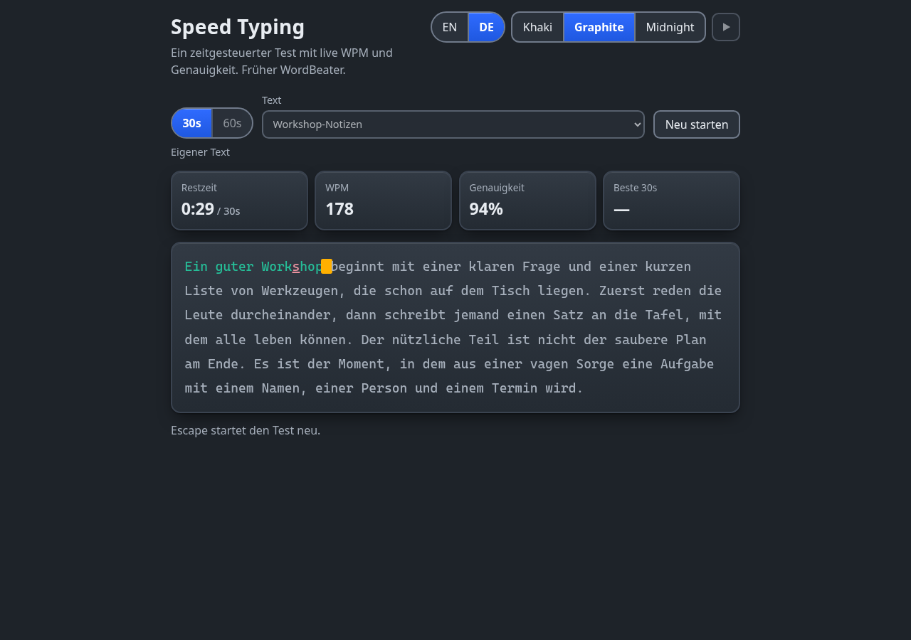

# Speed Typing

A timed typing test with live WPM, accuracy, and character highlighting. Choose 15, 30, 60 or 120 seconds, pick a text, and start typing. Your best score for each length is saved in `localStorage`.

**Live:** https://ali1129js.github.io/speedtyping-app/

Rebuilt in 2026 (original 2019, AI pair-programmed 2026). The 2019 app was called WordBeater: a Create React App class component where you typed a single random word within five seconds. This version keeps the speed-typing idea, but uses a full passage, a proper timed test, and React 19 with strict TypeScript.

The public GitHub repo later only kept the built GitHub Pages files. The last source is commit `7e4e1ed` on this history.

## Screenshots

Desktop (1280px). Motion is off (the default). The UI is English or German; the EN/DE switch is in the header and is remembered like the theme.

**English, Khaki**



**English, Graphite**



**German, Khaki**



**German, Graphite**



## Features

- 15, 30, 60 or 120 second tests, each with its own stored best. The clock starts on the first character.
- Live words per minute and accuracy. WPM uses correct characters divided by five, over the time elapsed.
- Each character is marked correct, incorrect, or still to type. The current character is highlighted.
- Restart from the button, or by pressing Escape. The test is usable from the keyboard alone.
- A best score per duration, kept in `localStorage`, and a short list of recent finished tests.
- Paste your own passage (40 to 2000 characters). It is not kept unless you choose to remember it on this device.
- A short list of texts: original passages, plus public-domain excerpts from Alice's Adventures in Wonderland and Pride and Prejudice, and the traditional pangram. German uses its own set, including umlauts and ß.
- The UI is English or German. English is the default. The choice is remembered, like the theme, and sets the page language. Switching language also switches the practice passages.
- Three themes from the gloss colour scheme: Khaki (the default light background), Graphite and Midnight. The first visit follows the operating system. The choice is remembered. A button next to the switch can turn on a slow, optional background motion; it stays off if you prefer reduced motion.
- Desktop first. At 390 px wide the stats wrap to two columns and the layout does not scroll sideways.

Everything stays on your machine. There is no server and no account.

## Stack

Vite, React 19, TypeScript (`strict`, `noUncheckedIndexedAccess`, `exactOptionalPropertyTypes`), Zod 4, Vitest and Testing Library, ESLint, Prettier.

## Scripts

```bash
npm install
npm run dev         # http://localhost:5173/
npm run lint
npm run typecheck
npm test
npm run build       # type-checks, then builds to dist/
npm run preview
npm run shots       # headless Chrome screenshots of English and German in Khaki and Graphite, into docs/
```

See [docs/LEARN.md](docs/LEARN.md) for a short walk-through of the ideas used in the code.

## Deploying

`.github/workflows/deploy.yml` runs lint, typecheck, tests and build on every push and pull request, and deploys `dist/` to GitHub Pages when `main` or `master` changes (Pages source: GitHub Actions).

Live site: https://ali1129js.github.io/speedtyping-app/
